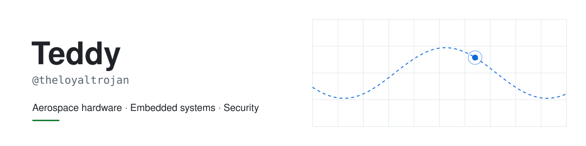

<picture>
  <source media="(prefers-color-scheme: dark)" srcset="./assets/banner-dark.svg">
  
</picture>

Student engineer working toward aerospace. I design flight electronics, build radio links from the protocol layer up, and take software apart to learn how it's defended.

### Building now

- **High-altitude balloon payload.** A custom flight computer PCB for a ~30 km flight, split into power, MCU, GPS, atmospheric sensing, radio tracking and logging. Designed in KiCad around an ATmega328P, with a u-blox GPS in airborne mode and an MS5611 pressure sensor rated to ~10 mbar.
- **LoRa mesh radio.** An off-grid, privacy-focused mesh protocol stack on SX1262 radios, designed layer by layer from scratch.
- **AERIS-10 phased-array radar.** Researching a build of the open-source X-band phased-array radar, starting with the cost and parts plan for its two variants.

### Selected work

| Project | What it is | Built with |
| :-- | :-- | :-- |
| [pentest_helper](https://github.com/theloyaltrojan/pentest_helper) | Command-line web pentest helper with recon, surface mapping, vuln and auth modules | Python, pytest, CI |
| [screen-translate-es-en](https://github.com/theloyaltrojan/screen-translate-es-en) | macOS overlay that OCRs a screen region and translates it live | Python, Tesseract |
| [hardwood](https://github.com/theloyaltrojan/hardwood) | Arcade basketball game in a single HTML file, everything procedurally generated ([play it](https://theloyaltrojan.github.io/hardwood/)) | JavaScript, Three.js |
| [lootdrop](https://github.com/theloyaltrojan/lootdrop) | Live feed of free game giveaways with filters and saved items ([live site](https://www.lootdrop.qd.je)) | React, Vite, Cloudflare Pages |
| [canvas-agent](https://github.com/theloyaltrojan/canvas-agent) | Serverless daily digest of upcoming Canvas assignments, sent to Telegram | Python, GitHub Actions |

### Toolbox

**Hardware** &nbsp; KiCad · ATmega328P · ESP32 · Arduino · LoRa (SX1262) · Raspberry Pi 
**Software** &nbsp; Python · C++ · JavaScript · React · GitHub Actions 
**Security** &nbsp; Nmap · Metasploit · Snort 3 · Scapy · Frida

<!-- Portfolio link goes here once the site is live:
**Portfolio** https://... -->
